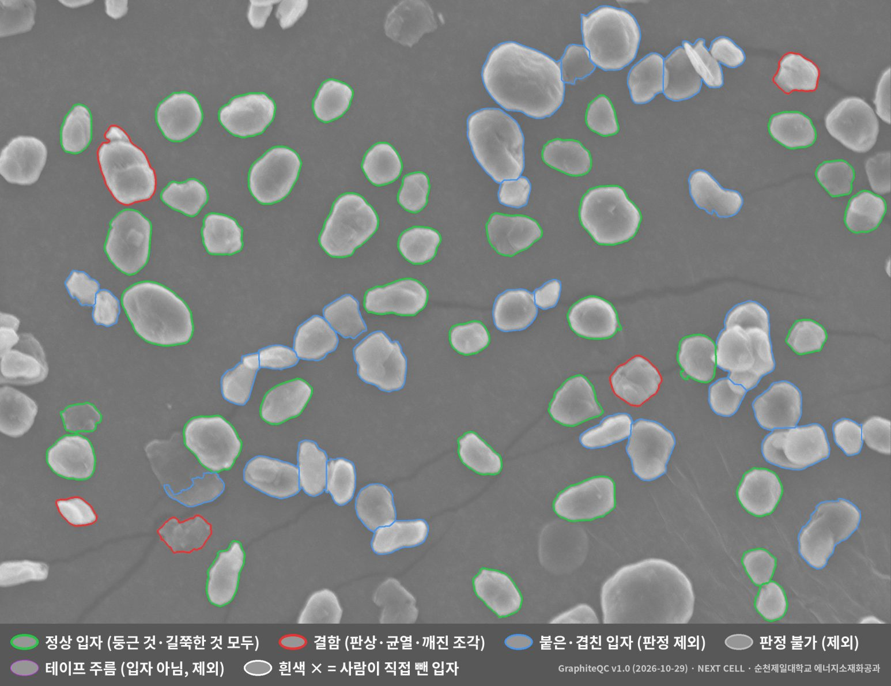

# NEXT CELL · SEM 입자 AI 품질검사 (GraphiteQC · ParticleQC)

**순천제일대학교 에너지소재화공과 NEXT CELL** — 윤성빈(팀장) · 김태욱 · 공진우 · 허동현

SEM 사진 속 입자를 하나씩 찾아 크기를 재고, 팀이 직접 분류한 입자로 학습한 AI가 결함 입자를 골라 시료 단위로 합격·불합격을 판정하는 프로그램입니다.



초록 = 정상 입자 · 빨강 = 결함(판상·균열·박리·깨진 조각) · 파랑 = 붙은·겹친 입자(판정 제외) · 회색 = 판정 불가 · 보라 = 테이프 주름

## 두 프로그램

| | GraphiteQC | ParticleQC |
|---|---|---|
| 대상 | 구형화 천연흑연 (음극재) | 어떤 입자든 (재료·배율·현미경 무관) |
| AI 모델 | 팀이 분류한 입자 2,418개로 학습된 모델 포함 | 없음 — 쓰는 사람이 자기 시료를 normal / abnormal / exclude 로 분류해 프로그램 안에서 학습 |
| 사진 | SEM ×2,000 (입도는 ×500도 가능) | 스케일(µm/px)과 대략적인 입자 크기만 입력 |
| 결과 | D10·D50·D90, 분포 폭, 원형도, 결함 비율과 95% 신뢰구간, 합격·불합격·판정 보류 | 같음 (abnormal 비율) |

두 프로그램 모두 겹친 입자를 자동으로 빼고, 사람이 결과를 보고 입자를 클릭해 판정(정상·결함·제외)을 직접 바꿀 수 있습니다. 바꾼 입자는 흰 점으로 표시되고 CSV에 자동 판정과 함께 남습니다.

## 내려받기

이 페이지 오른쪽 **Releases** 에서 `GraphiteQC.zip` 또는 `ParticleQC.zip` 을 받으세요.

## 설치와 실행 (Windows 10 / 11)

1. 받은 zip 파일을 마우스 오른쪽 → **압축 풀기**. 압축 파일 안에서 바로 실행하지 마세요.
2. 폴더 안의 **`1_처음_설치.bat`** 을 더블클릭합니다. 처음 한 번만, 5~10분, 인터넷이 필요합니다.
   "Windows의 PC 보호" 창이 뜨면 [추가 정보] → [실행].
3. Python 3.12 가 없으면 "Python 3.12 를 자동으로 설치할까요" 가 나옵니다. **Y** 를 누르면 python.org 에서 받아 설치합니다.
   다른 버전(3.14, 3.15 등)이 이미 있어도 그대로 두고 3.12 를 따로 씁니다.
   직접 설치하려면 [Python 3.12.10](https://www.python.org/downloads/release/python-31210/) 의 "Windows installer (64-bit)".
4. 설치가 끝나면 바탕화면 아이콘 또는 **`2_실행.bat`** 을 더블클릭합니다. 브라우저에 검사 화면이 열립니다.

설치한 뒤에는 인터넷 없이 동작하고, 사진은 내 컴퓨터 밖으로 나가지 않습니다.
자세한 사용법은 각 폴더의 `사용법.txt` 에 있습니다.

macOS · Linux 에서는 터미널에서 폴더로 이동한 뒤 (Python 3.12 기준, 3.10~3.13 도 됩니다):

```
python3.12 -m venv .venv
.venv/bin/pip install -r requirements.txt
.venv/bin/python app.py
```

## SEM이 없어도 바로 해 보기

`samples` 폴더의 사진은 팀이 직접 찍은 원본입니다. GraphiteQC에 그대로 올려 보세요.

| 파일 | 시료 | 촬영 조건 |
|---|---|---|
| `original_x2000_05.jpg` | 원래 흑연 | ×2,000 · 20 kV · SE · 2576×1932 |
| `original_WD6mm_20261028_1823.jpg` | 원래 흑연 (다시 찍음) | ×2,000 · 20 kV · SE · WD 6 mm · 2026-10-28 18:23 |
| `ground4min_20261028_1400.jpg` | 4분 동안 갈아서 일부러 손상시킨 흑연 | ×2,000 · 20 kV · SE · 2026-10-28 14:00 |

## 검증 결과 (GraphiteQC)

학습 데이터: SEM 사진 36장에서 팀이 직접 분류한 입자 2,418개 (구형 1,226 · 비구형 332 · 결함 192 · 판정 불가 668).
학습에 쓰지 않은 사진으로 예측하는 사진 단위 5겹 교차검증으로 사람 판정과 비교했습니다.

| 결함 입자 비율 | 사람 판정 | AI (교차검증) |
|---|---|---|
| 원래 흑연 | 10.7% | 11.2% |
| 4분 갈이 (손상 시료) | 15.5% | 13.1% |

프로그램 판정 (기준: 결함 15% 이하): 원래 흑연 20장 합산 11.4% **합격**, 4분 갈이 8장 합산 18.8% **불합격**.
사진 한 장은 판정 입자가 수십 개뿐이라 ±5%p 안팎 흔들리므로 여러 장을 합산하고, 95% 신뢰구간이 기준에 걸치면 '판정 보류'로 사진을 더 찍도록 안내합니다.

## 팀이 한 일

- 문제 정의와 결함 기준 — 결함은 '둥글지 않음'이 아니라 판상·균열·박리·깨진 조각
- 시료 준비와 SEM 촬영 — 원래 흑연, 4분 동안 갈아 손상시킨 흑연, 조건을 바로잡아 다시 찍은 흑연
- SEM 사진 36장에서 입자 2,418개를 직접 분류(라벨링)
- 합격 기준 결정, 사람 판정과 AI 판정을 비교한 검증
- 실제 사진으로 시험하며 문제를 찾고 수정 방향 결정

프로그램 코드는 팀이 정한 기준과 요구에 맞춰 AI 코딩 도구(Claude)로 작성했습니다.
무엇을 왜 이렇게 만들었는지는 [개발과정.md](개발과정.md)에 있습니다.

## 라이선스

[MIT License](LICENSE) © 2026 NEXT CELL (윤성빈, 김태욱, 공진우, 허동현), 순천제일대학교 에너지소재화공과.
누구나 쓰고 고치고 나눠 줄 수 있으며, 그때 이 저작권 표시를 남겨야 합니다.
